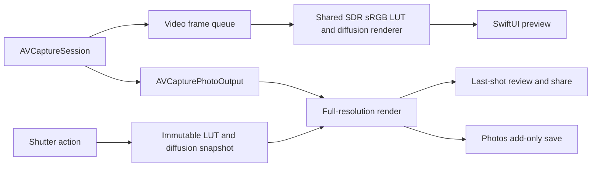

# Native iOS architecture

Status: native iOS implementation with the F10 diffusion extension integrated in source. The user chose SwiftUI after comparing it with a shared Flutter UI. Android remains a later platform implementation. CI passes all 45 core tests, 16 Apple renderer tests and 3 simulator UI tests. Physical-device validation and the remaining manual interaction/accessibility checks are pending. See the [diffusion implementation plan](../planning/diffusion-implementation.md).

## Components

| Component | Responsibility | Validation |
| --- | --- | --- |
| `Sources/LutliCore` | Bounded .cube parsing, starter LUT generation, labels/palette, five-slot persistent library, diffusion state/settings | Swift package tests on Linux/macOS |
| `ios/Lutli/Camera` | AVFoundation lifecycle and controls, LUT/diffusion rendering, full capture recipe, still capture, Photos saving | Apple-framework tests and physical iPhone checks |
| `ios/Lutli/App` | Main-actor application state, look selection, session diffusion settings, preferences, timer and library coordination | Apple-platform integration/UI checks |
| `ios/Lutli/Views` | SwiftUI camera, diffusion tray, looks collection, editor, controls, menu and review | Simulator/device layout and accessibility checks |
| `ios/project.yml` | Reproducible Xcode project definition | XcodeGen followed by Xcode build/tests |

## Camera and rendering flow

The preview and still paths share the LUT/diffusion processing contract:

Session configuration and camera-device mutations are serialized on a dedicated queue. Preview rendering uses a separate queue, discards late frames, and bounds UI frame delivery. The initial preview is limited to a 1280-pixel long edge and 15 delivered frames per second; its practical latency, quality, and energy use require measurement on real devices. Captured photographs use the full configured still dimensions, not the preview buffer.

One reusable Core Image context converts into the SDR sRGB processing/output contract. Filter instances are local to rendering operations. Preserve an embedded source image profile so Display P3 data is converted rather than reinterpreted as sRGB. The blended LUT and diffusion settings are frozen together at shutter time; changing either while a photo is processing must not change that photo.

The first implementation is portrait-only. Preview framing uses aspect fit and maps touch coordinates through the displayed image rectangle. Portrait rotation, front-camera mirroring and output orientation need physical-device verification.

## F10 implementation: diffusion and colored halation

The feature is implemented in source. The [feature specification](../planning/feature-specification.md), [implementation plan](../planning/diffusion-implementation.md) and [M4a roadmap](../planning/roadmap.md) separate the behavior from its remaining validation gates.

`DiffusionState` owns one active effect and independently remembered HDF/Black Mist strengths. It starts Off on every fresh app launch. HDF's initial 35% strength with Neutral glow and Black Mist's 20% strength are development values, not calibrated optical-filter equivalents. The immutable `DiffusionSettings` normalizes finite strength/color components and prevents Black Mist from inheriting HDF tint.

The `LUTRenderer.Recipe` contains the already blended LUT data plus diffusion settings. A lock protects both fields: changing the LUT retains the existing effect, and changing the effect retains the LUT. The camera service takes a value snapshot at the shutter action, so subsequent look, strength or glow-color edits cannot alter an in-flight photo. Algorithm parameters are fixed by the running renderer implementation.

`DiffusionRenderer` adds spatial processing after LUT grading. It derives a thresholded highlight mask from the ungraded, clamped input's peak RGB component so saturated lights can contribute as well as white lights. Neutral HDF and Black Mist use the graded highlight color; named/custom HDF colors tint the highlight contribution before blurring. Close and wide Gaussian layers are combined and screen-composited over the graded base. Black Mist also applies a restrained blend with a softened base for local contrast reduction.

Only the soft-light and softening layers are downscaled to a maximum 640-pixel long edge. The base image retains full capture resolution, and blur radii are fractions of the working image dimensions. The soft layers are scaled back for compositing, with the original extent and origin restored. This bounds blur work and defines proportional preview/photo glow. The Apple fixture tests pass, including resolution scaling; physical-image review must still establish final photographic quality and behavior across supported cameras.

Off or 0% effect strength returns the graded image without running diffusion. Original or 0% look intensity leaves an active diffusion effect in place. The optional clean-original JPEG is rendered directly from the capture before both creative stages, retaining camera exposure/WB processing; it is still a processed JPEG, not RAW. The `.cube` import contract and stored LUT files are unchanged.

`LutliAppModel` keeps diffusion in session memory independently of look preferences. Settings survive LUT/lens changes, tray dismissal, Off/reselection and background/foreground within that app session. Remember-last-look restores only the look; diffusion is not written to disk.

The implemented SwiftUI tray overlays the preview's lower edge and expands upward from Filters beside EV/WB. Preview geometry, permanent toolbar, LUT strip and shutter stay fixed. The tray intercepts its own touches, hides the lens controls while open, and offers bounded scrolling, selected-state accessibility labels and Reduce Motion support. The simulator interaction tests pass; manual custom-color-picker, VoiceOver and compact-device review remain pending.

The portable suite passes 45 tests, including diffusion state and immutable-setting behavior. Apple CI passes 16 renderer tests (9 diffusion tests plus the 7 existing tests) and 3 simulator UI tests, with zero failures at application commit `3497cf8`. Coverage includes bypass, glow locality/tint, resolution scaling, full-recipe capture, clean-copy exclusion and tray interactions; see the [validation record](../validation.md) for the run evidence and limits. Final mask/strength tuning, skin-tone and dark-scene review, latency, memory and thermal measurements remain physical-device work. Manual custom-color-picker and VoiceOver checks are also outstanding.

## LUT contract

- UTF-8 `.cube`, maximum 8 MiB, 3D sizes 17 or 33.
- Red changes fastest, then green, then blue; Core Image receives packed RGBA Float32 samples with alpha 1.
- Inputs and output samples are normalized to 0–1. Non-default domains, 1D LUTs, unknown directives and invalid/nonfinite samples produce explicit errors.
- Intensity blends each cube sample with its identity-grid sample. This avoids a separate preview-only grading path.
- Original and the six built-in looks are deterministic generated LUTs. They are original starter grades, not measurements or licensed recreations of named film stocks.

## Persistence and failures

The `LookLibrary` actor owns custom metadata and LUT files. Its JSON index is versioned. Files use generated UUID names, never user-supplied filenames. New imports write their data first, then atomically commit the metadata index; an index failure does not consume a slot. Replacing a LUT atomically replaces the payload while keeping its identity. Deleting commits the index before best-effort cleanup, so a cleanup failure can leave an unreferenced file but not an index pointing at a removed file.

Unreadable/corrupt stored libraries are preserved and reported. Built-in looks remain usable; the app does not silently reset or delete the user's files. Preferences and built-in intensities use UserDefaults. Imported file access is security-scoped and data is copied into application-managed storage on save.

Camera permission is requested for capture; Photos add-only permission is requested when saving. The most recent rendered capture remains available to share even if Photos access is denied or saving fails. There is no account, remote backend, or automatic media upload.

## Platform and release boundaries

Use the local Swift package for logic that can be validated without Apple SDKs. Linux syntax parsing does not establish SwiftUI/AVFoundation type correctness. Core Image pixel tests run in the iOS test target; camera, Photos, orientation, performance, and accessibility need Apple-platform execution.

The checked-in XcodeGen specification generates the project on macOS. Bundle identifier and signing team must be configured by the application owner before device distribution. The About/legal content is development copy; final publisher, feedback and policy details, app icon/release assets, and signing/distribution remain release gates.

For Android, reuse the product contract, label palette, reference fixtures, and compatible LUT assets. SwiftUI and AVFoundation are intentionally native to iOS and will require platform-specific equivalents.
