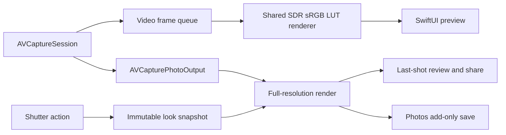

# Native iOS architecture

Status: selected for the first implementation. The user chose native iOS after comparing it with a shared Flutter UI. Android remains a later platform implementation.

## Components

| Component | Responsibility | Validation |
| --- | --- | --- |
| `Sources/LutliCore` | Bounded .cube parsing, starter LUT generation, labels/palette, five-slot persistent library | Swift package tests on Linux/macOS |
| `ios/Lutli/Camera` | AVFoundation lifecycle and controls, Core Image rendering, still capture, Photos saving | Apple-framework tests and physical iPhone checks |
| `ios/Lutli/App` | Main-actor application state, look selection, preferences, timer and library coordination | Apple-platform integration/UI checks |
| `ios/Lutli/Views` | SwiftUI camera, looks collection, editor, controls, menu and review | Simulator/device layout and accessibility checks |
| `ios/project.yml` | Reproducible Xcode project definition | XcodeGen followed by Xcode build/tests |

## Camera and rendering flow

Session configuration and camera-device mutations are serialized on a dedicated queue. Preview rendering uses a separate queue, discards late frames, and bounds UI frame delivery. The initial preview is limited to a 1280-pixel long edge and 15 delivered frames per second; its practical latency, quality, and energy use require measurement on real devices. Captured photographs use the full configured still dimensions, not the preview buffer.

One reusable Core Image context converts into the SDR sRGB processing/output contract. Filter instances are local to rendering operations. Preserve an embedded source image profile so Display P3 data is converted rather than reinterpreted as sRGB. The selected LUT and intensity are frozen at shutter time; changing the selected look while a photo is processing must not change that photo.

The first implementation is portrait-only. Preview framing uses aspect fit and maps touch coordinates through the displayed image rectangle. Portrait rotation, front-camera mirroring and output orientation need physical-device verification.

## LUT contract

- UTF-8 `.cube`, maximum 8 MiB, 3D sizes 17 or 33.
- Red changes fastest, then green, then blue; Core Image receives packed RGBA Float32 samples with alpha 1.
- Inputs and output samples are normalized to 0–1. Non-default domains, 1D LUTs, unknown directives and invalid/nonfinite samples produce explicit errors.
- Intensity blends each cube sample with its identity-grid sample. This avoids a separate preview-only grading path.
- Original and the six built-in looks are deterministic generated LUTs. They are original starter grades, not measurements or licensed recreations of named film stocks.

## Persistence and failures

The `LookLibrary` actor owns custom metadata and LUT files. Its JSON index is versioned. Files use generated UUID names, never user-supplied filenames. New imports write their data first, then atomically commit the metadata index; an index failure does not consume a slot. Replacing a LUT atomically replaces the payload while keeping its identity. Deleting commits the index before best-effort cleanup, so a cleanup failure can leave an unreferenced file but not an index pointing at a removed file.

Unreadable/corrupt stored libraries are preserved and reported. Built-in looks remain usable; the app does not silently reset or delete the user's files. Preferences and built-in intensities use UserDefaults. Imported file access is security-scoped and data is copied into application-managed storage on save.

Camera permission is requested for capture; Photos add-only permission is requested when saving. The most recent rendered capture remains available to share even if Photos access is denied or saving fails. There is no account, remote backend, or automatic media upload.

## Platform and release boundaries

Use the local Swift package for logic that can be validated without Apple SDKs. Linux syntax parsing does not establish SwiftUI/AVFoundation type correctness. Core Image pixel tests run in the iOS test target; camera, Photos, orientation, performance, and accessibility need Apple-platform execution.

The checked-in XcodeGen specification generates the project on macOS. Bundle identifier and signing team must be configured by the application owner before device distribution. The About/legal content is development copy; final publisher, feedback and policy details, app icon/release assets, and signing/distribution remain release gates.

For Android, reuse the product contract, label palette, reference fixtures, and compatible LUT assets. SwiftUI and AVFoundation are intentionally native to iOS and will require platform-specific equivalents.
