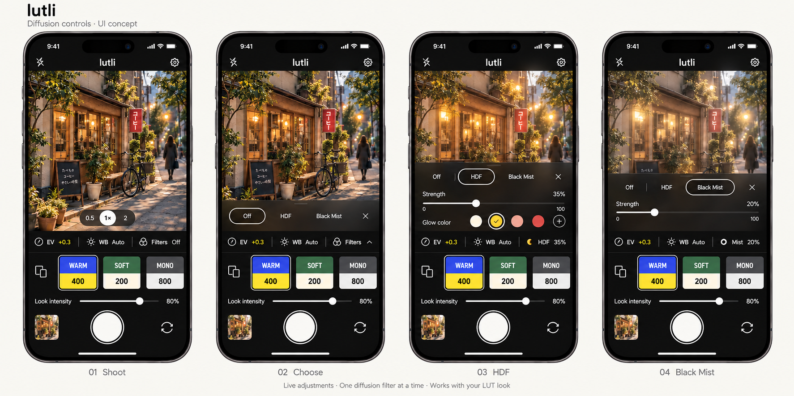
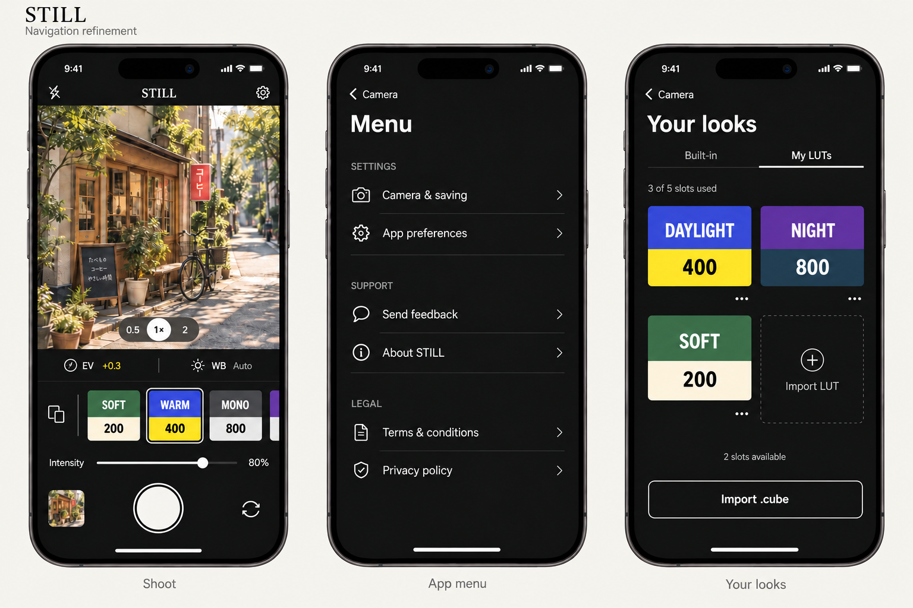
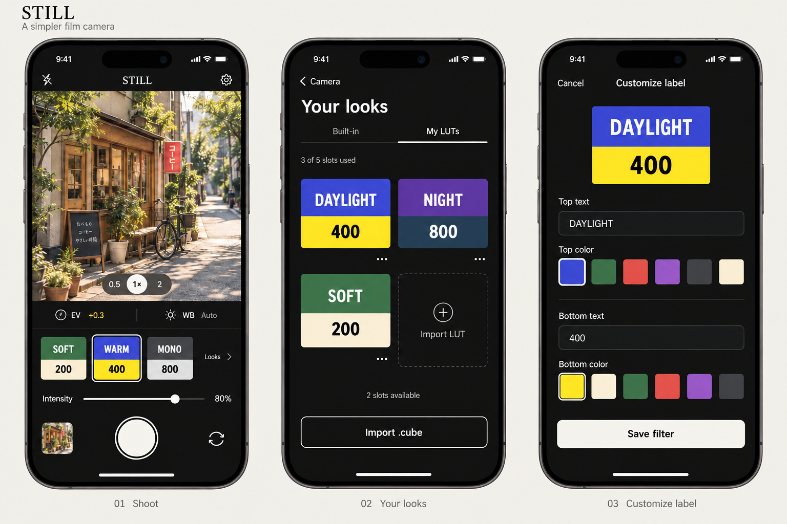

# UI and navigation specification

The current direction is a minimalist dark camera interface with restrained monochrome controls and colorful, two-section filter labels. This is a design baseline that can evolve during development, not a pixel-locked specification.

The latest approved shooting design adds **Filters** beside EV and WB, with HDF and Black Mist diffusion controls. This extension is specified in [F10](feature-specification.md#f10--diffusion-filters-and-halation), and its model, controls and rendering are implemented. The Apple build, 45 portable tests, 16 renderer tests and 3 simulator UI tests passed. The [implementation plan](diffusion-implementation.md) tracks the integration and checks, and the [validation record](../validation.md) identifies their scope. Photographic quality/performance, manual custom-color-picker interaction and VoiceOver/accessibility review remain outstanding; neither the concept nor the selected automated UI flows establish complete UI validation.

## Latest approved shooting concept

This is the current shooting-screen reference, using the **lutli** wordmark. It supersedes the camera portion of the earlier navigation concept. The four states show the interaction, not four separate destinations: **Shoot → Choose → HDF**, with **Black Mist** as the alternative selection.

The artwork is a static UI concept. The illustrated HDF 35% with Amber glow and Black Mist 20% are examples, not calibrated effects. The source implementation begins each app launch Off and uses HDF 35% with Neutral glow or Black Mist 20% on first selection as development tuning values. The image does not establish rendering accuracy, measured strength, or interactive behavior.

## Earlier references for app menu and label management

The retained concepts below show the retired placeholder **STILL**. Their branding is superseded by **Lutli**, with a lowercase **lutli** wordmark. Use them for the app menu, Your looks and label editor; use the latest concept above for shooting controls.

### App menu and Your looks

The fixed leading library icon remains the navigation reference. It supersedes the trailing `Looks` link visible in the earlier label-editor concept below.

### Filter identity and label editor

Use this image for the label-editor layout and two-section label system. The numbered captions belong to the original concept board and are not route identifiers.

## Shooting screen

Keep the existing visual hierarchy:

1. Top toolbar with flash control, app wordmark, and the upper-right gear.
2. Large live camera preview, with supported lens choices near its lower edge.
3. A permanent three-part toolbar: exposure, white balance, and Filters. Show current values, such as `EV +0.3`, `WB Auto`, and `Filters Off` or `HDF 35%`.
4. Horizontal look strip with a smaller library icon at its leading edge, followed by two-color filter labels.
5. **Look intensity** slider for the current LUT, visually distinct from diffusion **Filter strength**.
6. Bottom row with last-capture preview, primary shutter, and camera switching.

The first small icon opens **Your looks**. It is a navigation control, not a neutral filter. The current interaction proposal keeps it fixed while the labels scroll horizontally beside it. The previous trailing `Looks` link is removed.

Tapping a filter label selects the look. Mark the selected label with a simple outline. The last-capture thumbnail may remain photographic; filter selectors use graphic labels instead of photographic thumbnails.

The implementation places Original immediately after the library button, with `ORIGINAL / RGB` on charcoal and cream.

## Filters interaction

The Filters tool controls diffusion and colored halation independently of LUT grading. Its choices are **Off**, **HDF**, and **Black Mist**. One diffusion effect can be active alongside any built-in or imported LUT; effect stacking is outside this extension.

### State flow

| State | Controls and transition |
| --- | --- |
| Collapsed / Off | Toolbar reads `EV +0.3 · WB Auto · Filters Off`. Tap Filters to open the choices. |
| Choose | A compact tray opens over the lower preview. Its single horizontal row contains Off, HDF, Black Mist and a close control. The selected choice has a white outline. |
| HDF | Tap HDF to select it and expand the same tray upward. Keep the choices row, then show strength from 0–100%, a percentage readout, and Glow color swatches. |
| Black Mist | Tap Black Mist to select it. Show the choices row and its own 0–100% strength slider. This mode has neutral diffusion and no glow-color controls. |
| Collapsed / Active | Close the tray or tap outside it. Keep the applied effect and show `HDF 35%` with a small color indicator, or `Mist 20%`, in the toolbar. Tap that same control to reopen the active effect's controls. |

Selecting an effect applies its current-session settings immediately. Closing the tray keeps that result; there is no Save step. Selecting Off bypasses diffusion and preserves its remembered session values for later reselection. Changing HDF to Black Mist replaces the active effect; each retains its own strength.

### Layout and motion

- Keep EV, WB and the Filters control visible below the preview in every state. Opening Filters does not replace the EV/WB row.
- Reveal choices horizontally within the tray. Selecting HDF expands its detail rows upward; choosing Black Mist reduces the tray height to fit its fewer controls.
- Overlay the lower preview without changing its framing, aspect ratio or touch-coordinate mapping. Keep the look strip, look-intensity slider, last-photo entry and shutter at their existing positions.
- Hide the lens selector while the tray covers it, then restore it on collapse. Expanded controls must not pass taps through to camera focus.
- Keep the shutter usable when capture is otherwise ready. Opening EV, WB, the app menu or Your looks closes the diffusion tray without resetting the applied effect.
- Use restrained animation and respect Reduce Motion. Swiping the choices must not scroll the LUT strip or the whole shooting interface.
- At larger text sizes, allow the tray contents to scroll within the available preview area while preserving readable controls and the shutter. Do not force the small presentation sizes in the artwork onto accessibility layouts.

### HDF strength and glow color

For this design, **HDF** means highlight diffusion with optional colored halation. Concentrate glow around bright light sources and highlight edges. Keep the subject's detail and the underlying scene color recognizable.

Show a continuous **Strength** slider and its numeric percentage. Its accessible name is **HDF filter strength**. Percentages are creative effect amounts, not equivalences to physical optical-filter grades. At 0%, diffusion contributes no effect; show `HDF 0%` accurately while retaining the chosen mode and color.

The Glow color row offers **Neutral**, **Amber**, **Rose**, **Red**, and **Custom (+)**. Neutral follows the highlight color after the selected LUT grade without adding a tint. Custom opens a system color picker for an opaque color; strength controls the effect amount. Apply tint to the highlight glow, not the entire image.

Custom-color changes preview immediately. Dismissing that picker retains the current color, consistent with closing the diffusion tray; opening and dismissing it without an edit preserves the prior selection.

Use an outline/checkmark and an accessible color name to identify selection. Include the selected color name when space permits and always expose it to VoiceOver. The small color indicator in the collapsed toolbar supplements the effect name and percentage; color alone must not communicate the active state.

### Black Mist strength

Black Mist combines neutral highlight bloom with gentle contrast softening. Show only **Strength**, its percentage and the slider; its accessible name is **Black Mist filter strength**. Avoid stale HDF color controls or a colored active indicator in this mode. At 0%, the selected LUT rendering remains unchanged by diffusion.

### State and rendering expectations

- Start a fresh app launch with diffusion **Off**. Keep effect selection, each mode's strength, and HDF color during the current app session, including LUT/lens changes, panel navigation and background/foreground transitions. The existing Remember last look preference applies to the LUT and does not restore diffusion on a fresh launch.
- Original and 0% Look intensity remove LUT grading only. A selected diffusion effect remains active until disabled separately. A fully ungraded, undiffused creative output uses Original with Filters Off.
- Adjust the live preview immediately and freeze the complete LUT/diffusion recipe when the shutter fires. Later control changes must not alter an in-flight photo.
- The optional clean-original copy excludes both the creative LUT and diffusion/halation. The ordinary filtered copy includes the selected combination.
- Match the apparent glow size and strength across preview and full-resolution capture. The implementation extracts highlights before grading, composites glow after the LUT, and normalizes the soft effect layers while retaining the full-resolution base image. Development amounts and visual appearance still require photographic tuning; the concept illustration is not a reference pixel test.

See [F10](feature-specification.md#f10--diffusion-filters-and-halation) for acceptance checks and the [roadmap](roadmap.md) for implementation and validation gates.

## App menu

The upper-right gear opens a separate app menu. The current grouping is:

| Group | Entries |
| --- | --- |
| Settings | Camera & saving; App preferences |
| Support | Send feedback; About Lutli |
| Legal | Terms & conditions; Privacy policy |

The baseline implements these routes; final publisher, feedback and legal content remain release requirements. Exposure, white balance and the new diffusion tool belong on the shooting screen. LUT collection management is reached through the leading library icon.

## Your looks

- Separate Built-in and My LUTs collections.
- Use the same two-section labels as the camera strip.
- Show the custom collection count; `3 of 5` in the concept illustrates the proposed five-slot limit.
- Provide an import action and per-look management actions for custom looks.
- Importing a compatible LUT leads to **Customize label** before the look is saved.
- Editing an existing custom label also opens **Customize label**.

Rename, replacement, deletion, full-capacity behavior, and selection behavior follow F05–F07 in the [feature specification](feature-specification.md). Diffusion controls do not consume custom-LUT slots or change the label editor.

## Customize label

Show a live preview of the label above two independent editing groups:

| Section | Editable properties |
| --- | --- |
| Top | Top text and a color selected from a predefined palette |
| Bottom | Bottom text and a color selected from a predefined palette |

Either text section accepts short words or numbers. Example text such as `DAYLIGHT / 400` does not set camera exposure or ISO.

Use a clear Save filter action and a cancel/back path. Saving updates the label wherever that look appears. Cancel discards the draft, with confirmation when there are unsaved label changes, as specified in F07.

The implementation chooses black or white lettering using the stronger contrast. Both sections share an eight-color palette and accept 1–12 characters after trimming. Text is preserved as entered. See the [feature specification](feature-specification.md) for current validation rules.

## White balance and exposure

The proposed white-balance panel offers Auto, Lock, and Manual modes, followed by temperature and tint controls when supported. Selecting a manual value should have an explicit relationship to the active mode.

The implementation keeps white balance and exposure session-wide while intensity belongs to each look. Validate this behavior on real devices before release.

Exposure compensation belongs to the automatic-exposure workflow. Any later manual shutter/ISO mode needs its own coherent exposure interaction.

## Prototype checks

- Verify that the leading library icon is discoverable and reachable while browsing looks.
- Keep its visible icon small while providing at least a 44-point touch target.
- Check label readability, selection states, text scaling, contrast, and screen-reader naming.
- Check one-handed access, safe areas, compact displays, and the keyboard layout in the label editor.
- Confirm that cancel/back navigation preserves the appropriate camera state and existing filter data.
- Keep final label colors, spacing, and behavior adaptable as real-device testing reveals constraints.
- Verify that expanding diffusion controls preserves preview framing and the positions of the look strip and shutter; check touch routing, Reduce Motion and large text.
- Verify Off/0% behavior, separate look/effect strength, current-session restoration, and clear accessible effect/color selection. Portable model, Apple renderer and selected simulator UI checks pass. Manual custom-color-picker interaction, VoiceOver/accessibility and physical-device review remain outstanding in the [validation record](../validation.md).
