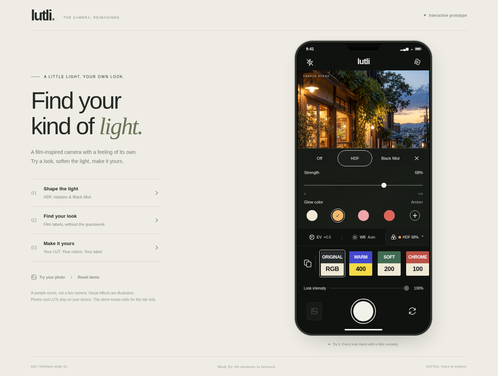

# Lutli interactive browser prototype

Open [`docs/prototype/lutli.html`](../../docs/prototype/lutli.html) in a current Chrome, Edge, Firefox or Safari browser. Download the file first if you are viewing it on GitHub; GitHub's source view does not run HTML. The standalone file includes its image, icons, styles and scripts. No installation, server, account or network connection is required by the prototype.



## Explore

- Select a two-color film label and adjust **Look intensity**. Browse the strip with touch/trackpad, a mouse wheel, or Left/Right arrow keys while a look is focused.
- Open **Filters** beside EV/WB. Try HDF strength and Neutral/Amber/Rose/Red/custom glow colors, or Black Mist strength. Closing the tray preserves the effect; each effect remembers its own strength.
- Adjust sample exposure and Auto/Lock/Manual white balance. These controls illustrate camera behavior on a still image.
- Open **Your looks** from the smaller, fixed library icon. Choose **My LUTs → Try with a demo LUT**, or import your own compatible `.cube`. Customize the two text sections and palette colors, then save and select the look.
- Import, edit, replace and delete up to five custom looks. Imports support normalized SDR sRGB 17³/33³ 3D `.cube` files, up to 8 MiB. Imported LUTs actually grade the sample using trilinear interpolation.
- Use the app menu to try grid, timer and clean-original settings. Capture a sample, open the thumbnail and download its JPEG. A clean copy is available if enabled at capture time.
- On desktop, **Try your photo** uses a local image instead of the supplied sample. The three side links jump directly to the main flows. **Reset demo** returns to the initial state.

Everything stays in the current browser tab. Reloading removes custom looks, captures and preferences and starts diffusion Off. This is intentionally separate from the native app's persistent library. No camera access, uploads, analytics or automatic Photos saving occur.

## Scope

The browser prototype is an interaction reference for the [approved UI/UX](../../docs/planning/ui-ux.md), not a port of the production iOS renderer. Canvas blur/color handling and exposure/WB are approximations. Flash and front-camera controls demonstrate state and mirroring; the sample is not a live camera. Remember-last-look and haptics are identified as native-app preferences in the prototype.

The cafe sample is an original AI-generated image made for this prototype. It is not a photograph captured with Lutli. Native camera, photographic quality, accessibility and performance validation remain in the [validation record](../../docs/validation.md).

## Edit and rebuild

Sources are intentionally small and dependency-free:

| File | Purpose |
| --- | --- |
| `markup.html` | Page, phone layout and screen structure |
| `styles.css` | Responsive interface and reduced-motion styling |
| `app.js` | Navigation, session state, import/editor and capture flows |
| `renderer.js` | Canvas preview and `.cube` parser/interpolator |
| `assets/demo-scene.png` | Embedded sample scene |
| `build.py` | Produces the portable HTML file |

After editing sources, run from the repository root:

```bash
python3 prototypes/lutli/build.py
```

The build uses only Python's standard library. The generated file is committed so reviewers can open it directly. Do not edit the generated HTML by hand.

Browser checks use the Node.js `playwright` package and Chromium as development tools; neither is required to use the prototype. With those tools available, run:

```bash
node prototypes/lutli/tests/smoke.cjs
```

The script uses `CHROMIUM_PATH` if provided, `/usr/bin/chromium` when available, or Playwright's installed browser. `SCREENSHOT_DIR` optionally controls where screenshots are written. Its temporary local server closes after the checks. See the [validation record](../../docs/validation.md) for actual results.
